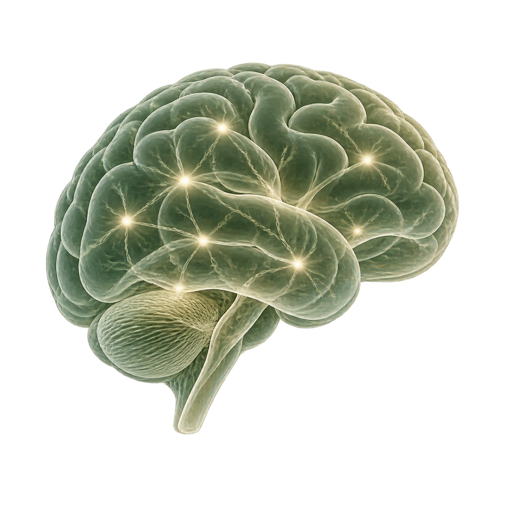
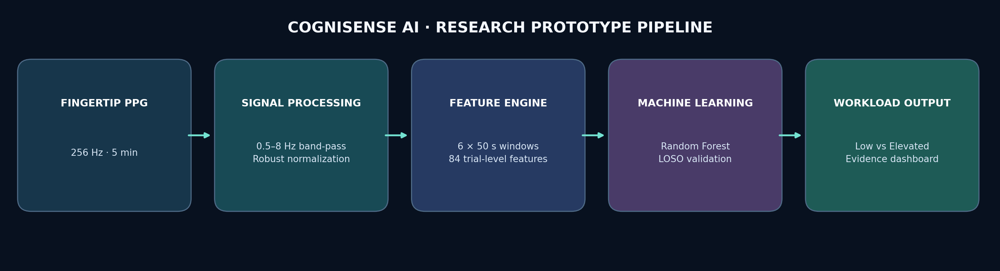
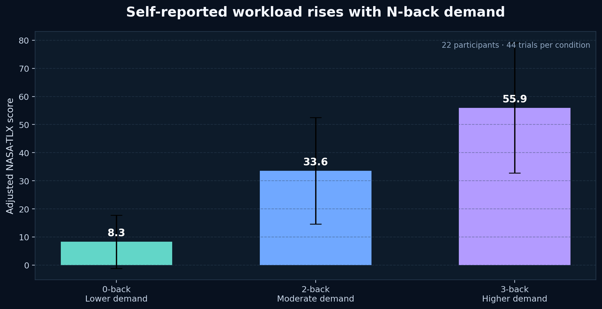
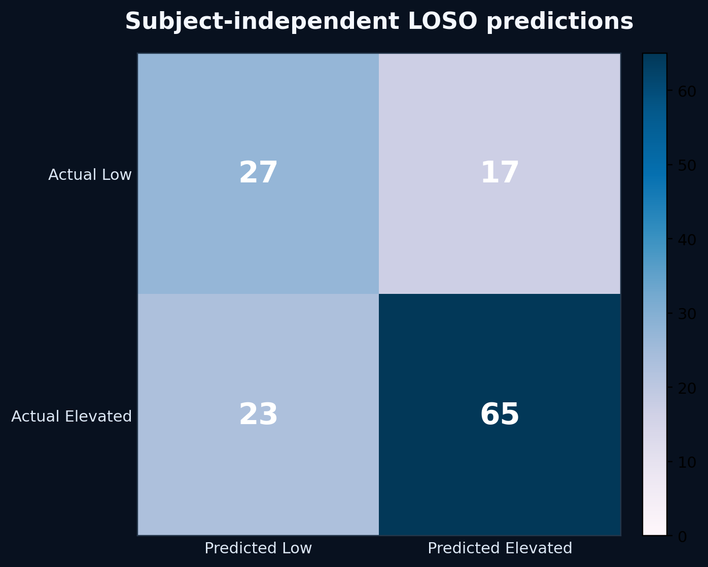

# CogniSense AI

**A multimodal cognitive-workload research observatory built around wearable physiological signals.**

<p align="center">
  
</p>

<p align="center">
  <strong>22 participants</strong> · <strong>132 recorded trials</strong> · <strong>4 physical sensor modalities</strong> · <strong>22-fold subject-independent evaluation</strong>
</p>

CogniSense AI is a local-first research application for exploring physiological responses during N-back tasks and reviewing machine-learning evidence for low versus elevated task-demand conditions. It combines a responsive research dashboard, signal inspection tools, cohort visualization, and saved model-evaluation results in one workspace.

> **Research scope:** the N-back condition is used as an experimental task-demand proxy. CogniSense does not directly measure a person’s internal mental state, brain activity, stress, or clinical condition. It is a research prototype, not a medical device.

## Project at a glance

| Area | Description |
|---|---|
| Dataset | MAUS — *A Dataset for Mental Workload Assessment on N-back Task Using Wearable Sensor* |
| Cohort | 22 participants, 6 trials each (132 participant-trials) |
| Trial duration | 300 seconds |
| Task conditions | 0-back, 2-back, and 3-back |
| Binary target | 0-back = Low; 2-back + 3-back = Elevated task demand |
| Validation | Leave-One-Subject-Out (LOSO), 22 outer participant-held-out folds |
| Interface | Local web dashboard; no cloud account or hosted backend required |

## What you can explore

- **Overview** — dataset scope, sensor coverage, cohort summary, and NASA-TLX context.
- **Signal Studio** — inspect recorded 20-second waveform windows for a selected participant, trial, and 50-second segment.
- **Cohort Map** — explore a three-dimensional PCA projection of the multimodal trial feature space and filter by task or participant.
- **Model Evidence** — compare modality-level and all-sensor-fusion results using accuracy, balanced accuracy, macro-F1, and ROC-AUC.
- **Research** — review the processing and evaluation workflow, evidence, and limitations.

The interface uses a restrained forest-green/graphite visual system. The overview features a translucent 3D brain illustration with independently rotating orbital paths; the brain remains stationary.

## Sensor modalities

| Modality | Description | Sampling rate | Source recorded in MAUS |
|---|---|---:|---|
| ECG | Single-lead electrocardiogram | 256 Hz | ProComp Infiniti |
| Fingertip PPG | Palmar photoplethysmography | 256 Hz | ProComp Infiniti |
| Wrist PPG | Wrist-worn photoplethysmography | 100 Hz | PixArt PPG watch |
| GSR / EDA | Galvanic skin response / electrodermal activity | 256 Hz | ProComp Infiniti |

Derived interval streams are also analyzed: ECG-derived RRI, fingertip-PPG-derived PPI, and wrist-PPG-derived PPI. These are derived measures, not additional physical sensors.

NASA-TLX and PSQI are treated as reference/context variables and are **not used as predictive model inputs**. Behavioural response-log summaries are descriptive and are not used as classifier predictors.

## Saved evaluation evidence

The repository includes saved out-of-fold predictions and modality comparison metrics from the 22-participant MAUS cohort. The table below reports the current exploratory binary comparison stored with the application.

| Input | Balanced accuracy | ROC-AUC |
|---|---:|---:|
| ECG | 47.2% | 0.471 |
| Fingertip PPG | 54.5% | 0.647 |
| Wrist PPG | 48.9% | 0.549 |
| GSR / EDA | 56.8% | 0.661 |
| IBI / HRV | 49.4% | 0.573 |
| All-sensor fusion | 60.2% | 0.598 |

A separate fingertip-PPG reference baseline is retained in `data/research_evidence.json`: accuracy 69.7%, balanced accuracy 67.6%, macro-F1 67.0%, and ROC-AUC 0.718 using 84 features and grouped inner-threshold selection. This is a separately documented reference result, not the same run as the modality comparison table above.

These are internal estimates from a small, single-dataset cohort. Fusion is not assumed to be superior simply because it combines sensors. Interpret balanced accuracy, class-wise errors, and ROC-AUC together; external validation is still required.

### Research figures

<p align="center">
  
</p>

<p align="center">
  
  
</p>

## Quick start — Windows

**Requirements:** Windows 10/11, Python 3.11 (recommended) or 3.12, and an internet connection for the first dependency installation.

1. Download or clone this repository and extract it if downloaded as a ZIP.
2. Install Python 3.11 or 3.12 from [python.org](https://www.python.org/downloads/). During setup, enable **Add Python to PATH**.
3. Open the project folder.
4. Double-click **`run_cognisense.bat`**.
5. On first launch, the script creates `.venv`, installs `requirements.txt`, and starts the local server.
6. The dashboard opens at **http://127.0.0.1:8501**. If it does not open automatically, paste that address into your browser.

Keep the terminal window open while using the dashboard. Press **Ctrl+C** in that window to stop the server.

### Run manually

```powershell
py -3.11 -m venv .venv
.venv\\Scripts\\Activate.ps1
python -m pip install --upgrade pip
pip install -r requirements.txt
python server.py
```

## Dataset access and repository contents

The full original `MAUS.zip` archive and curated `maus_research_subset.zip` are intentionally **not committed** to this public repository. Dataset access and reuse are governed by the original provider’s terms. Obtain the full archive through the official [IEEE DataPort record](https://doi.org/10.21227/q4td-yd35), where available to you, and place the file here if you are authorized to use it:

```text
data/MAUS.zip
```

- The saved feature tables, predictions, metrics, and research evidence required by the main dashboard are included.
- Raw MAUS recording archives and the curated subset are not committed to this public repository.
- **Without `data/MAUS.zip`:** Overview, Cohort Map, Model Evidence, and Research remain available. Signal Studio displays a clear notice because raw waveform inspection requires the original archive.
- **With an authorized `data/MAUS.zip`:** all four raw sensor channels can be inspected in Signal Studio.
- If you use the optional legacy fingertip-PPG utility in `src/cognisense_core.py`, obtain the curated subset separately and place it at `data/maus_research_subset.zip` under its original terms.
- Both `data/MAUS.zip` and `data/maus_research_subset.zip` are listed in `.gitignore` so raw recordings are not accidentally redistributed.

Do not redistribute the full dataset or the curated subset outside the original dataset’s access and reuse terms. Cite the dataset in reports, posters, demonstrations, and publications.

## Project structure

```text
cognisense-ai/
├── data/
│   ├── chunks/                         # saved participant-level feature chunks
│   ├── research_evidence.json          # dataset and research evidence
│   ├── modality_metrics_*.json         # saved modality comparison metrics
│   ├── *_loso_predictions.csv          # out-of-fold predictions
│   └── *.csv                           # feature, PCA, quality, and context tables
├── research_figures/                   # generated research figures
├── src/
│   ├── cognisense_core.py              # fingertip-PPG feature/model utilities
│   └── multimodal_core.py              # multimodal feature and signal utilities
├── static/
│   ├── index.html                      # responsive dashboard
│   ├── neural-brain.png                # overview brain visual
│   ├── cognisense-mark.svg              # brand mark
│   └── plotly.min.js                   # local Plotly.js bundle
├── server.py                           # local HTTP server and JSON API
├── build_research_assets.py            # research-asset generation script
├── build_data_chunk.py                 # data chunk helper
├── requirements.txt
├── run_cognisense.bat
├── DATASET_ATTRIBUTION.txt
├── RUN_ME_FIRST.txt
└── RUN_ME_FIRST_BN.txt
```

## Technology stack

- **Python** — local server and research utilities
- **NumPy / pandas** — numerical processing and tabular data
- **SciPy** — filtering, signal processing, and statistical features
- **scikit-learn** — machine-learning models, preprocessing, PCA, and evaluation
- **HTML / CSS / JavaScript** — responsive front end
- **Plotly.js** — interactive charts and 3D cohort visualization

## Network and privacy notes

The application is designed to run locally. The server binds to the host interface so another device on the same trusted private Wi-Fi can optionally open the LAN address printed in the terminal. Do not expose this research server directly to the public internet or an untrusted network. No hosted deployment or live wearable connection is included in this build.

## Limitations

- The MAUS cohort contains 22 participants from one acquisition protocol.
- N-back task condition is a proxy for experimental task demand, not a direct label of a person’s internal workload state.
- NASA-TLX and PSQI are contextual/reference variables, not predictive inputs.
- Independent cohort and hardware validation are required before generalization can be claimed.
- Live sensor acquisition, prospective intervention testing, and clinical validation are outside the current scope.
- CogniSense AI is not intended for diagnosis, treatment, or safety-critical decisions.

## Dataset citation

MAUS: *A Dataset for Mental Workload Assessment on N-back Task Using Wearable Sensor*. IEEE DataPort. DOI: [10.21227/q4td-yd35](https://doi.org/10.21227/q4td-yd35).

See [`DATASET_ATTRIBUTION.txt`](DATASET_ATTRIBUTION.txt) for the project’s dataset attribution note.
